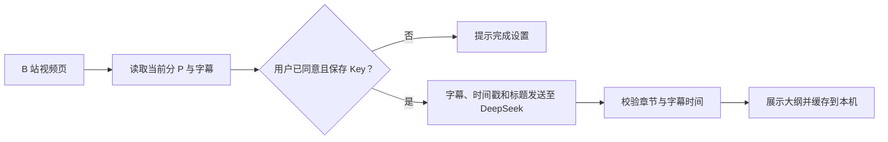

# bli-chapters

**把 B 站视频字幕整理成可跳转的章节大纲。**

`Bilibili` · `Chrome Manifest V3` · `DeepSeek` · `用户自备 API Key`

> 这是独立开发的第三方浏览器扩展，与哔哩哔哩和 DeepSeek 无关联。
> 当前仓库用于公开展示项目说明与隐私政策；插件源码和安装包尚未在此仓库发布。

## 它解决什么问题

遇到二十分钟以上的视频，想知道“讲了哪几个问题”“相关内容从哪里开始”，往往只能拖动进度条反复寻找。bli-chapters 根据当前视频、当前分 P 的**可读取字幕**，生成传统章节大纲：每章有标题、要点和可点击的起始时间。

| 使用时 | 插件会做什么 |
| --- | --- |
| 打开有字幕的 B 站视频 | 自动读取当前分 P 的字幕并生成章节 |
| 点击章节时间 | 跳到播放器对应位置 |
| 再次打开同一分 P | 优先显示本机缓存，避免重复调用 |
| 内容更新或结果不满意 | 手动重新生成 |
| 没有可用字幕 | 明确提示原因，不虚构视频内容 |

## 使用流程

1. 在扩展设置页阅读数据处理说明，确认同意，并填入**自己的** DeepSeek API Key。
2. 打开 `www.bilibili.com/video/*`。页面右下角的小卡片显示读取和生成进度；点击卡片展开大纲。
3. 点击章节时间跳转，或点击“重新生成”更新结果。也可以先点“检查字幕”，仅确认当前分 P 的字幕条数与时间范围，此操作不会请求 DeepSeek。

自动分析会消耗用户自己的 DeepSeek API 额度。设置页可以删除 Key、关闭自动分析、清空本地大纲缓存。

## 数据如何流动

- **发送给 DeepSeek：**当前分 P 的字幕文本、时间戳、视频标题，以及用于认证的用户 API Key。
- **保存在本机：**同意状态、API Key 和生成的大纲，使用 Chrome 扩展本地存储，不通过 Chrome 同步。完整字幕只在生成过程中使用，不长期保存。
- **开发者服务器：**没有中转服务器、广告分析服务或遥测。扩展只请求完成字幕读取与模型生成所需的站点权限。
- **设备风险：**本地存储不等于加密保险箱；能访问设备或浏览器配置的人仍可能读取这些数据。

完整说明见 **[隐私政策](https://baibaigithub.github.io/bli-chapters/)**。

## 当前边界

- 只支持 B 站视频页及当前分 P；不支持其他视频平台。
- 必须有可读取的字幕。第一版不做语音转写、画面识别或视频下载。
- 章节时间锚点来自真实字幕；标题和要点仍由模型生成，可能存在理解偏差。
- B 站字幕接口可能变化，部分字幕需要登录后才能读取。
- 超长字幕会停止自动分析，以免无意中产生过高费用。

## 项目与发布状态

当前公开仓库承载本说明和 GitHub Pages 隐私政策。插件尚未上架 Chrome 应用商店；**这里目前没有可安装的扩展包或完整源码**。请不要把仓库中的 `index.html` 当作插件安装文件。

隐私政策页面：[baibaigithub.github.io/bli-chapters](https://baibaigithub.github.io/bli-chapters/)

支持与反馈：[shaobai1993@163.com](mailto:shaobai1993@163.com)
